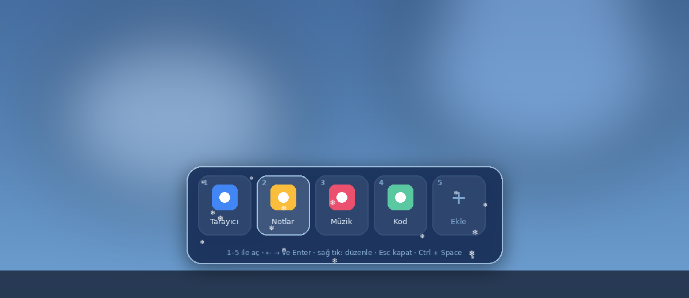

<div align="center">


# Ayaz Launcher

**Bir kısayola bas, ekranın altında 5 uygulamalık buzlu bir çubuk açılsın. Birine dokun, açılsın. ❄️**

[](https://github.com/Enskygr234/ayaz-launcher/releases/latest)
[](https://github.com/Enskygr234/ayaz-launcher/actions)



</div>

## ✨ Özellikler

- **Tek kısayol:** `Ctrl + Space` ile çubuk, farenin olduğu ekranın altında açılır (ayarlardan değiştirilebilir)
- **5 yuva:** Tıklayarak ya da `1`–`5` tuşlarıyla aç; `←` `→` ile gez, `Enter` ile başlat
- **Kolay düzenleme:** Boş yuvaya tıkla ve program seç. Sağ tıkla değiştir, taşı, kaldır ya da dosya konumunu aç
- **Sürükle-bırak:** Tepsi menüsünden *Yuvaları düzenle* deyip `.exe` ya da kısayol dosyasını yuvaya bırak
- **Buzlu cam görünümü** ve çubuğun içinde usulca yağan kar
- **Sistem tepsisinde** sessizce bekler, istersen Windows ile birlikte başlar
- **Kurulum yok:** Tek bir `.exe`, .NET kurmana gerek yok

## 🚀 Kullanım

1. [Son sürümden](https://github.com/Enskygr234/ayaz-launcher/releases/latest) `AyazLauncher.exe` dosyasını indir ve çalıştır
2. Çubuk ilk açılışta kendiliğinden görünür. Yuvalara programlarını ekle
3. Sonra istediğin an `Ctrl + Space` ile aç, `Esc` ile kapat

> Windows SmartScreen "tanınmayan uygulama" uyarısı verirse **Ek bilgi → Yine de çalıştır** de.

### ⌨️ Tuşlar

| Tuş | Ne yapar |
|---|---|
| `Ctrl + Space` | Çubuğu aç / kapat |
| `1` – `5` | O yuvadaki programı aç |
| `←` `→` `Tab` | Yuvalar arasında gez |
| `Enter` | Seçili yuvayı aç |
| `Esc` | Çubuğu kapat |
| Sağ tık | Değiştir, taşı, kaldır |

### 🧊 Tepsi menüsü

Saatin yanındaki kar tanesi simgesine sağ tıkla:

- **Çubuğu aç**
- **Yuvaları düzenle:** Çubuk açık kalır, programları sürükleyip bırakabilirsin
- **Kısayol tuşu:** Yeni bir tuş birleşimi seç
- **Windows ile başlat**
- **Çıkış**

Ayarlar `%AppData%\AyazLauncher\ayarlar.json` dosyasında saklanır.

## 🛠️ Derleme

[.NET 8 SDK](https://dotnet.microsoft.com/download/dotnet/8.0) ile:

```bash
dotnet run --project AyazLauncher
```

Tek dosya `.exe` için:

```bash
dotnet publish AyazLauncher -c Release -r win-x64 --self-contained -p:PublishSingleFile=true
```

Her `v*` etiketinde GitHub Actions `.exe` dosyasını derleyip sürüm olarak yayınlar.

---

<div align="center">

C# · WPF · .NET 8 &nbsp;|&nbsp; [Enskygr234](https://github.com/Enskygr234) tarafından ❄️ ile yapıldı

</div>
